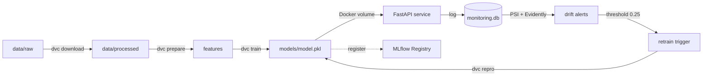

# Credit Card Default Prediction (MLOps Pipeline)


## О проекте

Автоматизированный MLOps-пайплайн для предсказания дефолта по кредитным картам (PD-модель).
Проект демонстрирует полный жизненный цикл ML-модели: от валидации данных и инженерии признаков до контейнеризации, мониторинга дрейфа и автоматического переобучения.

## Архитектура



## Технологический стек

- **Данные и признаки:** Pandas, Pandera (валидация), Scikit-learn (Pipeline)
- **Трекинг и версии:** MLflow (Tracking + Registry), DVC (Data Version Control)
- **Сервинг:** FastAPI, Uvicorn, Docker, Docker Compose
- **Мониторинг:** Evidently AI, PSI (Population Stability Index)
- **CI/CD:** GitHub Actions, GHCR (GitHub Container Registry)
- **Качество кода:** Pytest, Flake8, Black

## Структура проекта

```text
├── .github/workflows/   # CI/CD пайплайны
├── data/                # raw (gitignored) и processed данные
├── docs/                # Архитектура, Runbook и Proofs
├── models/              # Обученные модели (gitignored)
├── notebooks/           # EDA (01_eda.ipynb)
├── scripts/             # Скрипты автоматизации
├── src/                 # Исходный код (data, features, models, api, monitoring)
├── tests/               # Unit-тесты
├── dvc.yaml             # DVC пайплайн
├── params.yaml          # Гиперпараметры
└── requirements.txt     # Зависимости
```

## Быстрый старт

### 1. Подготовка окружения

**Windows:**
```powershell
python -m venv venv
.\venv\Scripts\activate
pip install -r requirements.txt
```

**macOS / Linux:**
```bash
python3 -m venv venv
source venv/bin/activate
pip install -r requirements.txt
```

### 2. Воспроизведение пайплайна (DVC)
Скрипт сам скачает данные с UCI, подготовит фичи и обучит модель:
```bash
dvc repro
```

### Примечание для Windows: настройка путей DVC

В некоторых конфигурациях Windows запуск `dvc repro` может завершаться ошибкой
`[WinError 5] Access is denied: 'C:\ProgramData\iterative'`. Это ограничение прав
доступа к системной папке, а не ошибка проекта. DVC по умолчанию пытается
использовать `C:\ProgramData\iterative` для системного конфига и кэша, и если у
текущего пользователя нет прав на запись в эту папку, DVC завершается до чтения
`dvc.yaml`.

Решение — однократно перенаправить системный, глобальный и site-кэш DVC в профиль
пользователя. Выполните в PowerShell:

```powershell
[Environment]::SetEnvironmentVariable("DVC_SYSTEM_CONFIG_DIR", "$env:USERPROFILE\.dvc\system", "User")
[Environment]::SetEnvironmentVariable("DVC_GLOBAL_CONFIG_DIR", "$env:USERPROFILE\.dvc\global", "User")
[Environment]::SetEnvironmentVariable("DVC_SITE_CACHE_DIR",   "$env:USERPROFILE\.dvc\site_cache", "User")
```

После этого закройте и снова откройте терминал, активируйте виртуальное окружение и запустите `dvc repro`.

### 3. Эксперименты (MLflow)
```bash
mlflow ui --backend-store-uri sqlite:///mlflow.db --port 5001
```
Откройте `http://127.0.0.1:5001`.

### Сравнение экспериментов

Пять запусков с разными гиперпараметрами (скрипт `scripts/run_experiments.ps1`).
Метрики выгружаются командой `python -m scripts.export_experiments` в `docs/proof/experiments.csv`.

| Эксперимент | n_estimators | max_depth | learning_rate | ROC-AUC | F1 | Precision | Recall |
|---|---|---|---|---|---|---|---|
| exp_100_3_0.05 | 100 | 3 | 0.05 | 0.7801 | 0.4693 | 0.6630 | 0.3632 |
| exp_100_5_0.1 | 100 | 5 | 0.1 | 0.7810 | 0.4569 | 0.6337 | 0.3572 |
| exp_200_5_0.1 | 200 | 5 | 0.1 | 0.7749 | 0.4609 | 0.6399 | 0.3602 |
| exp_200_7_0.05 | 200 | 7 | 0.05 | 0.7730 | 0.4543 | 0.6458 | 0.3504 |
| exp_300_7_0.1 | 300 | 7 | 0.1 | 0.7662 | 0.4612 | 0.6337 | 0.3625 |

**Лучший по ROC-AUC** — `exp_100_5_0.1` (0.7810), однако максимальные Precision (0.6630),
Recall (0.3632) и F1 (0.4693) достигаются при `exp_100_3_0.05`, где ROC-AUC отличается
всего на 0.0009. Для кредитного скоринга важнее не пропустить дефолт (Recall), поэтому
финальная модель выбрана по `exp_100_3_0.05`. Исходный GridSearchCV по 27 комбинациям
гиперпараметров независимо выбрал ту же область (n=100, depth=3, lr=0.1, ROC-AUC=0.7808),
что подтверждает стабильность региона.


### 4. Запуск API (Docker)

**Windows:**
```powershell
.\scripts\run_docker.ps1
```

**macOS / Linux:**
```bash
chmod +x scripts/run_docker.sh
./scripts/run_docker.sh
```

API будет доступно по адресу `http://127.0.0.1:8000/health`.
Документация Swagger: `http://127.0.0.1:8000/docs`.

## Тестирование и CI
```bash
black src tests
flake8 src tests
pytest tests/ -v
```

## Мониторинг и дрейф
```bash
python -m src.monitoring.simulate_traffic 100
python -m src.monitoring.report
python -m src.monitoring.evidently_report
```
Отчет Evidently сохраняется в `artifacts/drift_report.html`.

## Лицензия
Этот проект лицензирован под MIT License — см. файл [LICENSE](LICENSE).
