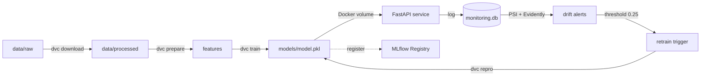

# Credit Card Default Prediction (MLOps Pipeline)


## О проекте

Автоматизированный MLOps-пайплайн для предсказания дефолта по кредитным картам (PD-модель).
Проект демонстрирует полный жизненный цикл ML-модели: от валидации данных и инженерии признаков до контейнеризации, мониторинга дрейфа и автоматического переобучения.

## Архитектура



## Технологический стек

- **Данные и признаки:** Pandas, Pandera (валидация), Scikit-learn (Pipeline)
- **Трекинг и версии:** MLflow (Tracking + Registry), DVC (Data Version Control)
- **Сервинг:** FastAPI, Uvicorn, Docker, Docker Compose
- **Мониторинг:** Evidently AI, PSI (Population Stability Index)
- **CI/CD:** GitHub Actions, GHCR (GitHub Container Registry)
- **Качество кода:** Pytest, Flake8, Black

## Структура проекта

```text
├── .github/workflows/   # CI/CD пайплайны
├── data/                # raw (gitignored) и processed данные
├── docs/                # Архитектура и Runbook
├── models/              # Обученные модели (gitignored)
├── notebooks/           # EDA (01_eda.ipynb)
├── scripts/             # Вспомогательные скрипты (run_docker.ps1, run_experiments.ps1)
├── src/                 # Исходный код (data, features, models, api, monitoring)
├── tests/               # Unit-тесты
├── dvc.yaml             # DVC пайплайн
├── params.yaml          # Гиперпараметры
└── requirements.txt     # Зависимости
```

## Быстрый старт

> **Примечание:** Файл `requirements.api.txt` содержит только легковесные зависимости для запуска API внутри Docker (FastAPI, Uvicorn). Локально для обучения и тестов достаточно установить основной `requirements.txt`.

### 1. Подготовка окружения
```bash

# Windows
python -m venv venv
.\venv\Scripts\activate

# Linux / macOS
python3 -m venv venv
source venv/bin/activate

pip install -r requirements.txt
```

### 2. Воспроизведение пайплайна (DVC)
Скрипт сам скачает данные с UCI, подготовит фичи и обучит модель:
```bash
dvc repro
```

### 3. Эксперименты (MLflow)
```bash
mlflow ui --backend-store-uri sqlite:///mlflow.db
# Откройте http://127.0.0.1:5000
```

### 4. Запуск API (Docker)
```powershell
.\scripts\run_docker.ps1
```
API будет доступно по адресу `http://127.0.0.1:8000/health`.
Документация Swagger: `http://127.0.0.1:8000/docs`.

## Тестирование и CI
```bash
black src tests
flake8 src tests
pytest tests/ -v
```

## Мониторинг и дрейф
```bash
python -m src.monitoring.simulate_traffic 100
python -m src.monitoring.report
python -m src.monitoring.evidently_report
```
Отчет Evidently сохраняется в `artifacts/drift_report.html`.

## Лицензия
Этот проект лицензирован под MIT License — см. файл [LICENSE](LICENSE).
