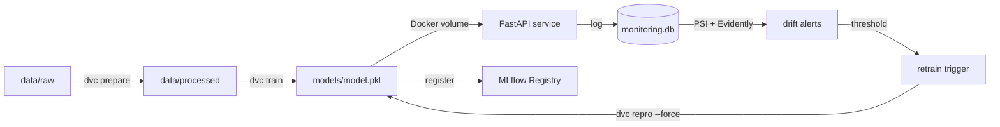

# Architecture

## Layers

## Reproduce the whole pipeline

    dvc repro
    docker compose up -d
    python -m src.monitoring.simulate_traffic 100
    python -m src.monitoring.report
    python -m src.monitoring.evidently_report
